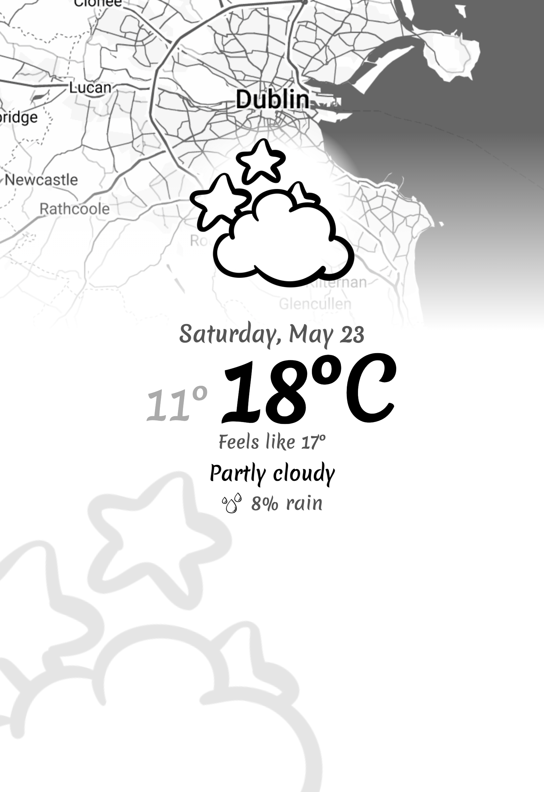
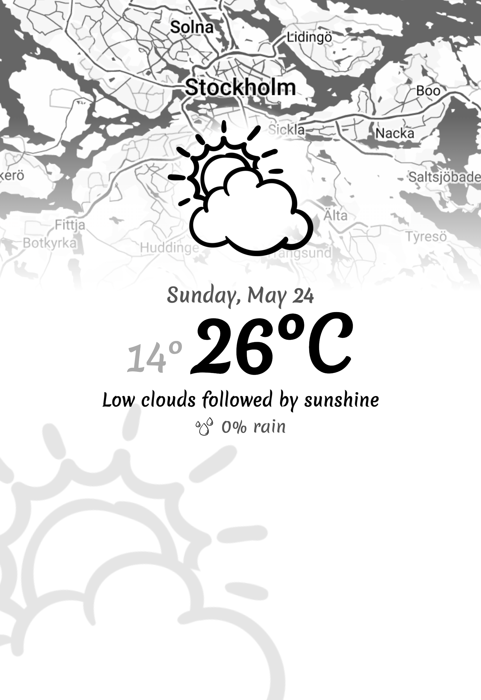
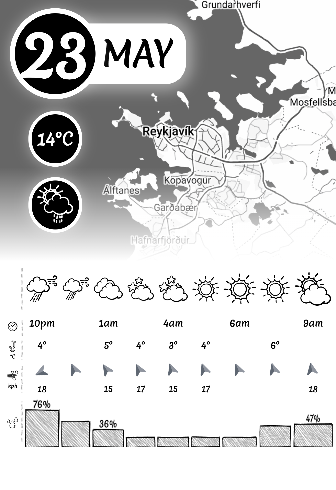
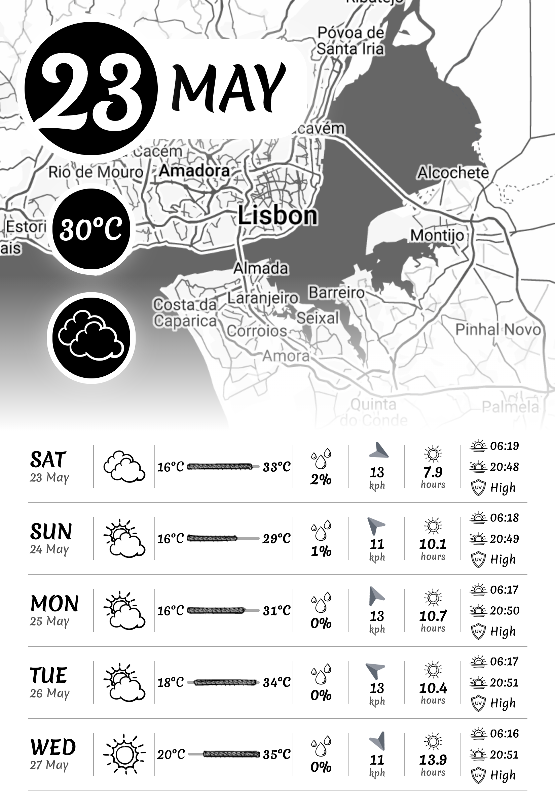

# Inkplate 10 Weather Calendar

[](https://github.com/chrisjtwomey/inkplate10-weather-cal/actions/workflows/build.yaml)
[](https://github.com/chrisjtwomey/inkplate10-weather-cal/actions/workflows/release.yaml)
[](CONTRIBUTING.md#coverage)
[](CONTRIBUTING.md#coverage)

The weather forecast and a map of your city, on an Inkplate 10 e-paper
display. The display wakes a few times a day, shows a new page, and sleeps.
One battery charge lasts one to two years.


The server renders five pages: today, current, hourly, daily and tomorrow.

<table align="center">
  <tr>
    <td align="center"><br/><sub>Today: the current weather, a map and a summary</sub></td>
    <td align="center"><br/><sub>Tomorrow: the forecast, with an icon and a phrase</sub></td>
  </tr>
  <tr>
    <td align="center"><br/><sub>Hourly: the next 9 hours</sub></td>
    <td align="center"><br/><sub>Daily: the next 5 days, with highs and lows</sub></td>
  </tr>
</table>

- [What you need](#what-you-need)
- [1. Set up the server](#1-set-up-the-server)
- [2. Set up the display](#2-set-up-the-display)
- [3. Settings on the SD card](#3-settings-on-the-sd-card)
- [How it works](#how-it-works)
- [More documentation](#more-documentation)
- [Background](#background)
- [License](#license)

## What you need

| Part | Cost | Notes |
|---|---|---|
| [Inkplate 10](https://www.crowdsupply.com/soldered/inkplate-10) | ~€150 | A 9.7" 1200x825 e-paper display with an ESP32, a real-time clock and battery charging. From [Soldered Electronics](https://soldered.com/product/soldered-inkplate-10-9-7-e-paper-board-with-enclosure-copy), or in the UK from [Pimoroni](https://shop.pimoroni.com/products/inkplate-10-9-7-e-paper-display?variant=39959293591635). |
| LiPo battery with a JST connector | ~€10 | 2000 mAh lasts one to two years. Some Inkplate 10s come with a 3000 mAh battery. |
| CR2032 coin cell (optional) | ~€1 | The server sets the clock at every wake. |
| A server | – | Anything that runs Docker, or Python 3.11 or later. A Raspberry Pi Zero 2 W uses little power. |
| Photo frame, 8"x10" | ~€10 | The mount shows only the e-paper area, about 5.5"x7.5". |
| microSD card (optional) | ~€5 | A settings change then needs no new firmware. Not for an E-Radionica Inkplate 10: see [the note below](#2-set-up-the-display). |

## 1. Set up the server

The server renders the pages and tells the display when to wake next.

1. Get an API key for a weather provider ([doc/weather-apis.md](doc/weather-apis.md)), and a Google Maps API key and map ID ([doc/google-static-maps.md](doc/google-static-maps.md)).
2. Make your config, and fill in the keys, the map ID and your location:

   ```sh
   cp server/config.example.yaml server/config.yaml
   ```

3. Start the server with Docker Compose, from the folder that holds [`docker-compose.yml`](docker-compose.yml):

   ```sh
   docker compose up -d
   ```

- The image tag `latest` follows every change to the main branch. For a server that changes only at a release, use a release's tag, such as `2.1`.
- The compose file keeps the display's log lines across updates, in a volume on `/app/data`.
- To run the server with `docker run`, or from source, and for every setting, see [server/README.md](server/README.md).

## 2. Set up the display

| | Settings come from | Firmware |
|---|---|---|
| With an SD card | `config.yaml` on the card | `firmware.factory.bin` from a [release](https://github.com/chrisjtwomey/inkplate10-weather-cal/releases/latest) |
| Without an SD card | `src/defaults.cpp`, built into the firmware | built from source |

**With an SD card:**

1. Put a `config.yaml` in the root of the card: see [3. Settings on the SD card](#3-settings-on-the-sd-card).
2. Download `firmware.factory.bin` from the [latest release](https://github.com/chrisjtwomey/inkplate10-weather-cal/releases/latest). It holds the bootloader, the partition table and the firmware.
3. Connect the display over USB, and flash it:

   ```sh
   pip install esptool
   esptool.py --chip esp32 --port /dev/ttyUSB0 write_flash 0x0 firmware.factory.bin
   ```

   This also clears the settings stored on the display. The card gives them back at the next start.

4. Put the card in and start the display.

**Without an SD card:** copy `src/defaults.example.cpp` to `src/defaults.cpp`, fill in your Wi-Fi and server address, and build and flash the `release` environment: see [CONTRIBUTING.md](CONTRIBUTING.md#client-firmware-development-platformio).

After the first flash, the display updates itself from the server: see [Firmware updates](server/README.md#firmware-updates).

> **E-Radionica Inkplate 10 (the older version):** it cannot turn off the SD card's power in deep sleep. With a card in, it draws about 2 mA in deep sleep, not 24 µA, and the battery lasts weeks. Set it up without a card. See [doc/power-consumption.md](doc/power-consumption.md).

## 3. Settings on the SD card

The display reads `config.yaml` from the root of the card at every start. A key the file leaves out keeps the firmware's value. Without `server.url`, `wifi.ssid` and `wifi.pass`, the display ignores the file. [doc/config.yaml](doc/config.yaml) explains each key.

```yaml
server:
  url: http://YOUR_SERVER_HOST:8080/today.png
  retries: 3
wifi:
  ssid: YOUR_WIFI
  pass: YOUR_WIFI_PASSWORD
  connect_timeout_seconds: 10
mqtt_logger:
  enabled: false
  broker: localhost
  port: 1883
  clientId: inkplate10-weather-calendar
  prefix: mqtt/weather-cal
  retries: 3
```

| Key | Firmware value | What it does |
|---|---|---|
| `server.url` | `http://YOUR_SERVER_HOST:8080/today.png` | The first page to fetch. After that, the server names the next one. |
| `server.retries` | `3` | How many more times to try a download or a draw that failed. |
| `server.default_refresh_seconds` | `3600` | How long to sleep when the server has not said. |
| `wifi.ssid` | – | The Wi-Fi network. |
| `wifi.pass` | – | The Wi-Fi password. |
| `wifi.connect_timeout_seconds` | `10` | How long to wait for Wi-Fi before this wake gives up. |
| `mqtt_logger.enabled` | `false` | Send the display's log lines to an [MQTT](server/README.md#mqtt) broker. |
| `mqtt_logger.broker` | – | The broker's host name or address. |
| `mqtt_logger.port` | `1883` | The broker's port. |
| `mqtt_logger.clientId` | `inkplate10-weather-client` | The name the display gives the broker. |
| `mqtt_logger.prefix` | `mqtt/weather-cal` | The display logs to `<prefix>/inkplate10-weather-cal`. |
| `mqtt_logger.retries` | `3` | How many times to try the broker before this wake gives up on it. |

`mqtt_logger.broker`, `clientId` and `prefix` come together. If the card gives only some of them, the display keeps its own three, and logs a warning.

## How it works

The server does the work, so the display can sleep most of the time.


At each wake, the display:

1. Connects to Wi-Fi, and to the MQTT broker if logging is on.
2. Downloads its page. The answer also sets its clock and time zone, and says when to wake next.
3. Draws the page. Unless the server offers a firmware update, Wi-Fi goes off before the panel refreshes, which is the longest step.
4. Sleeps until the time the server gave.

- **Power:** about 24 µA in deep sleep. A wake takes about 5 seconds: about a minute a day at 11 pages a day.
- **Time:** the real-time clock wakes the display. The server sends the seconds to the next refresh, so the display needs no time zone rules of its own.
- **Errors:** a message across the top of the last page, for example a flat battery, no Wi-Fi or a failed update. After a server failure the display backs off: 6 minutes, 18, 54, and so on, up to 24 hours.
- **Logs:** with MQTT on, the server keeps the display's log lines, and answers `GET /logs` with them.
- **Updates:** the display takes new firmware from the server, and shows a progress bar while it installs.

## More documentation

| Topic | Doc |
|---|---|
| Every server setting, Docker, firmware updates, MQTT | [server/README.md](server/README.md) |
| Weather provider API keys | [doc/weather-apis.md](doc/weather-apis.md) |
| Google Static Maps | [doc/google-static-maps.md](doc/google-static-maps.md) |
| Add a weather provider | [server/weather/README.md](server/weather/README.md) |
| Battery life and measurements | [doc/power-consumption.md](doc/power-consumption.md) |
| Build, flash and test the firmware | [CONTRIBUTING.md](CONTRIBUTING.md) |
| Another e-paper display | [epd's custom-board guide](https://github.com/chrisjtwomey/epd/blob/main/docs/custom-board.md) |

The firmware and the server are built on [epd](https://github.com/chrisjtwomey/epd). This repository holds what is weather-cal's own: the order of a wake, what it draws over a page, the weather providers and the five pages.

## Background

This project started from [MagInkCal](https://github.com/speedyg0nz/MagInkCal), which shows a Google calendar on e-paper from a Raspberry Pi Zero. An ESP32 uses far less power, and the project moved from calendar events to the weather. The same author's [MagInkDash](https://github.com/speedyg0nz/MagInkDash) has a similar design.

## License

All code in this repository is under the MIT license.

Weather icons by [lutfix](https://www.flaticon.com/authors/lutfix) from [www.flaticon.com](https://www.flaticon.com).
