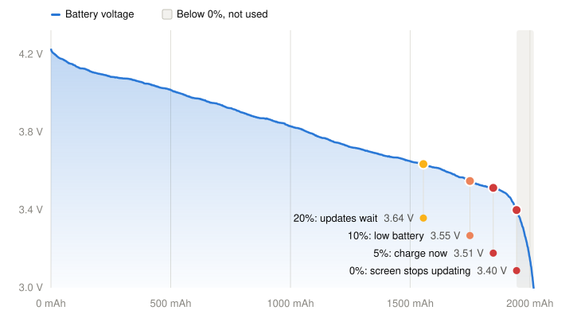
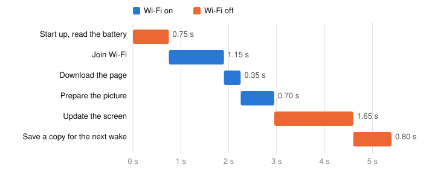

# Power consumption

How long a battery lasts, what the percentage on the screen means, and where
the charge goes. The figures are for an Inkplate 10 with a 2000 mAh LiPo and no
SD card.

## How long a battery lasts

A 2000 mAh battery runs the display for about 1.6 years before it asks for a
charge. On its own use alone it would last about 2.8 years, but a LiPo also
loses about 2% of its charge a month by itself.

| | Per day |
|---|---|
| Awake, 11 wakes | about 1.3 mAh |
| Asleep, the rest of the day | about 0.5 mAh |
| Lost by the battery itself | about 1.3 mAh |
| **Total** | **about 3.1 mAh** |

The currents were measured with a power profiler: about 80 mA while awake
and 21 µA asleep. One wake uses about 0.12 mAh.

## What the battery percentage means

The percentage comes from the battery's voltage, through a curve recorded on
this display: a full 2000 mAh battery drained at a steady 40 mA until it was
empty. It gave 2016 mAh in 50 hours.

<picture>
  <source media="(prefers-color-scheme: dark)" srcset="assets/battery-discharge-dark.svg">
  
</picture>

0% is 3.40 V, not the battery's own limit of 3.0 V. Below about 3.4 V the
screen's power chip may not start, so the display could wake but not update
the screen. That leaves about 70 mAh in the battery, the shaded band.

| Percent | Voltage | What the display does |
|---|---|---|
| 20% | 3.64 V | Waits for a charge before it installs a firmware update |
| 10% | 3.55 V | Logs "battery low, charge soon!" |
| 5% | 3.51 V | Shows "Battery critical, please charge!" and stops waking |

At 5%, charge the battery, then press the display's reset button: charging does
not wake it. Charge it within a few weeks of the warning: a LiPo left empty
for long can be damaged.

Each battery's curve is a little different, so the percentage is a guide, not
an exact figure.

## Where the charge goes in a wake

The display wakes at the times the server sets, gets the page, puts it on the
screen and goes back to sleep. A wake takes about 5.4 seconds, measured on an
Inkplate 10. Wi-Fi is on only while the display gets the page.

<picture>
  <source media="(prefers-color-scheme: dark)" srcset="assets/wake-steps-dark.svg">
  
</picture>

When a firmware update is waiting, Wi-Fi stays on until it is installed, and
the wake takes longer.

## SD card on the E-Radionica Inkplate 10

The older Inkplate 10, from E-Radionica, cannot turn off the SD card's power in
deep sleep. Measured on one in 2023:

| SD card | Current asleep |
|---|---|
| In, and used by the firmware | about 2 mA |
| In, not used | about 85 µA |
| Out | 24 µA |

At 2 mA the battery lasts weeks, not years. On this board, use the build
without SD card support and leave the card out. See
[Inkplate-Arduino-library issue 209](https://github.com/SolderedElectronics/Inkplate-Arduino-library/issues/209).
